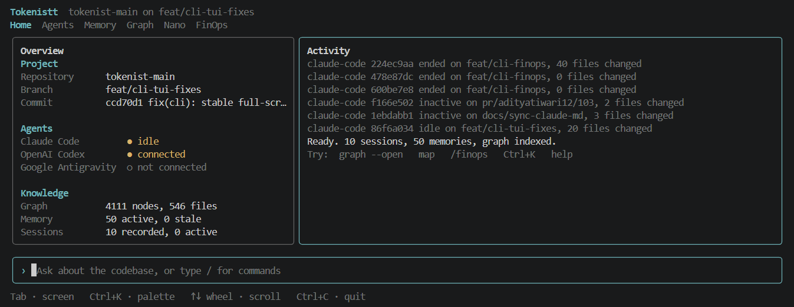

# tokenistt-cli

[](https://www.npmjs.com/package/tokenistt-cli)
[](https://github.com/Complete-tokenistt/tokenistt/blob/main/LICENSE)
[](https://nodejs.org)

The command line for [Tokenistt](https://github.com/Complete-tokenistt/tokenistt): open-source AI cost visibility and governance, with developer intelligence for your repositories. The command you run is `tokenistt`.

```bash
npm install -g tokenistt-cli
tokenistt --help
```

It has two halves:

- **Gateway client.** Talks to your self-hosted Tokenistt gateway, the same one the dashboard uses, so numbers in the terminal are the numbers on the dashboard: `login`, `connect`, `doctor`, `usage`, `cost`, `models`, `providers`, `policy`, `optimize`.
- **Local developer intelligence.** Works inside a git repository with no gateway and no network: a codebase knowledge graph, coding-agent session recording, project memory, context for agents, change impact and search. Data lives in `.tokenistt/` in the repo.

Use either half alone. Nothing leaves your machine unless you run `sync --enable`.

> **Status: early (0.1.x).** Claude Code integration has been run live; Codex and Antigravity are written from their docs and unverified. There is no hosted service: the CLI only ever talks to a gateway you run. See [Roadmap](#roadmap).

**Links:** [Source and issues](https://github.com/Complete-tokenistt/tokenistt) · [Dashboard and gateway setup](#the-dashboard) · [Full project README](https://github.com/Complete-tokenistt/tokenistt#readme) · [Agent capabilities](https://github.com/Complete-tokenistt/tokenistt/blob/main/docs/cli/AGENTS.md)

## Your first 5 minutes

New to Tokenistt? You need Node.js 22.13+ and a Git repository. Then:

```bash
npm install -g tokenistt-cli
cd /path/to/your-project
tokenistt setup           # guided: project, agent hooks, optional code map, optional gateway, final check
tokenistt run claude      # start Claude Code here; cost and activity show in its status bar
```

That is the whole loop. `setup` explains each step as it goes, can be re-run safely, and works with no gateway (`--yes` accepts the defaults for scripts). When your agent exits, `run` prints a summary: time, tokens, estimated cost, files changed. Open `tokenistt` any time for the dashboard, and `tokenistt doctor` if something looks wrong.

- **Codex or Antigravity?** `tokenistt run codex` works the same way, with the summary at the end (their live status bar is not available; see [Coding agents](#coding-agents)).
- **Want to watch from a second pane instead?** `tokenistt watch`.
- **Have a gateway?** `setup` offers to link it; or run `tokenistt login` later. Local features never need one.

The rest of this README is reference. Skip to what you need:

## How to use this README

| I want to… | Go to |
|---|---|
| Get going the first time | [Your first 5 minutes](#your-first-5-minutes) |
| Install and try it | [Install](#install), [Quick start](#quick-start) |
| Open the dashboard | [The dashboard](#the-dashboard) |
| Understand my codebase, find what a change affects | [Codebase graph](#codebase-graph), [Change impact](#change-impact), [Search](#search) |
| Record and review coding-agent sessions and their cost | [Coding agents](#coding-agents) |
| Give agents project knowledge | [Project memory](#project-memory), [Context for agents](#context-for-agents), [MCP](#mcp) |
| See spend, set policies, get savings suggestions | [Commands](#commands) (`usage`, `cost`, `policy`, `optimize`) |
| Log in, script it, use it in CI | [Credentials](#credentials), [Use in CI](#use-in-ci) |
| Fix an error | [Troubleshooting](#troubleshooting), [Exit codes](#exit-codes) |
| Find every command and flag | [Commands](#commands), or `tokenistt <command> --help` |

## Install

Requires **Node.js 22.13 or newer** (the local database uses Node's built-in SQLite). Check with `node -v`.

```bash
npm install -g tokenistt-cli      # puts `tokenistt` on your PATH
tokenistt --version
tokenistt doctor                  # checks the install and tells you how to fix anything red
```

Or run it once without installing: `npx -p tokenistt-cli tokenistt --help`. To work from source instead, see [Development](#development).

Update with `npm install -g tokenistt-cli@latest`; remove with `npm uninstall -g tokenistt-cli`. Agent hooks written by `agents connect` point at the installed file, so run `tokenistt agents connect <agent>` again after moving or reinstalling.

### Use it on any of your projects

Run `tokenistt setup` inside any Git repository (see [Your first 5 minutes](#your-first-5-minutes)). Or step by step: `tokenistt init`, `tokenistt agents connect claude-code`, `tokenistt map`, then `tokenistt` for the interactive app.

Everything local (`init`, `map`, `search`, `impact`, `memory`, `context`, `sessions`, `graph`, `run`) works without a
gateway. Gateway features (FinOps spend, usage, budgets) need `tokenistt login` against your own running gateway;
without it the FinOps screen says no gateway is configured, and `doctor` reports the gateway checks as skipped, not failed. Sync to the gateway is off unless you turn it on per
repository. Claude Code is the agent verified against the real agent; Codex and Antigravity hooks are written from their docs.

## The dashboard

The dashboard is a separate web app in the same open-source repository: **https://github.com/Complete-tokenistt/tokenistt**. The CLI does not bundle or start it; you run the Tokenistt stack yourself (Docker is the easy way) and the CLI connects to it.

```bash
git clone https://github.com/Complete-tokenistt/tokenistt.git
cd tokenistt
node scripts/setup.mjs                  # writes .env with fresh secrets; never overwrites an existing one
docker compose up --build -d            # postgres, redis, migrations, gateway, dashboard
```

| What | Where |
|---|---|
| **Dashboard** | http://localhost:3001 (opens without a login by default; see the repo README for `AUTH_MODE`) |
| **Gateway** (OpenAI-compatible) | http://localhost:3000/v1 |
| API reference | http://localhost:3000/v1/openapi.json |

Ports are configurable with `DASHBOARD_PORT` and `GATEWAY_PORT`. Then point the CLI at it:

```bash
tokenistt login            # asks for the gateway URL (http://localhost:3000) and a credential
tokenistt connect          # finds your organization, workspaces and projects
tokenistt doctor           # every check should be green
```

Use the **gateway** URL (port 3000) for the CLI, not the dashboard's. To also see this repository's sessions and graph summary on the dashboard, run `tokenistt sync --dry-run` to preview, then `tokenistt sync --enable`. Full stack, configuration and API documentation: [project README](https://github.com/Complete-tokenistt/tokenistt#readme).

## The interactive app

Bare `tokenistt` in a set-up repository, on a terminal, opens a persistent app. In pipes, CI or with `--json` it
prints a plain status instead, so scripts never get stuck.



The prompt at the bottom is always live. Type a question to search the graph and memory, a `/command` to move around, or any real command (`graph --open`, `map`, `doctor`, `usage`...) to run it in place and watch its output stream into Activity. `help` lists everything.

| Screen | Shows |
|---|---|
| Home | Project and agent status, plus a live activity feed that narrates real changes (sessions starting, errors, new memories, gateway up or down) |
| Agents | Connected agents and their sessions: state, tokens, estimated cost, files changed, tests |
| Memory | What the project remembers; stale entries are marked `?` |
| Graph | Node and relationship counts, largest areas, most depended-on symbols |
| Nano | Placeholder. Not built yet; shows nothing measured |
| FinOps | Tabs for **Overview**, **Models**, **Daily**, **Weekly** and **Sessions**: tokens and cost from your gateway's ledger (needs `tokenistt login`), and, separately, coding-agent usage recorded on this machine. Weeks start on Monday (UTC). Switch tabs with `[` and `]`, the arrow keys on an empty prompt, or a click |

| Key | Action |
|---|---|
| Type + Enter | Plain text searches the graph and memory; text starting with `/` runs a command (`/agents`, `/finops`, `/search`, `/refresh`, `/clear`, `/help`, `/quit`) |
| `Tab` / `Shift+Tab` | Next / previous screen (completes a command while typing `/…`) |
| `Ctrl+K` | Command palette |
| Up / Down, PgUp / PgDn, mouse wheel | Select or scroll. `Home` / `End` go to the oldest / newest |
| Click | A tab switches screen, the prompt starts typing at that spot, a list row selects it |
| `Ctrl+L` | Clear the activity feed |
| `Ctrl+C` | Quit |

The mouse is on while the app is open, so drag does not select text: hold `Shift` to select and copy. Turn the mouse off with `TOKENISTT_NO_MOUSE=1`.

Windows: works in Windows Terminal, PowerShell and the VS Code terminal. Consoles that can't draw box characters get plain ASCII
automatically; force it with `TOKENISTT_ASCII=1`. Costs shown for local agents are estimates (tokens times catalog
prices), not your bill.

### Costs

A session's cost is its tokens times your model prices. There are no built-in prices. They come from:

1. your gateway's catalog, saved to `.tokenistt/cache/prices.json` by `tokenistt models --refresh` (the app also refreshes it when it is older than a day and the gateway is connected); and
2. your own `.tokenistt/prices.json`, which wins where both name a model. It is a map of model id to `{ "input": 3, "output": 15, "cachedInput": 0.3, "cacheWrite": 3.75 }` in USD per million tokens.

A model is found by the id the vendor reports; a trailing date (`-20250929`) or a `provider/` prefix is dropped only to reach an id your table already has. Nothing is guessed. Where a model, or a cache price, is missing, that part is left out and said so: you see `~$4.20 known + 18,000 tokens unpriced` and which models need a price, never a total that hides the gap.

## Quick start

**A. Local only (no gateway needed).** Run inside any git repository:

```bash
tokenistt init                       # creates .tokenistt/ (git-ignored data) and the local database
tokenistt map                        # build the codebase graph; re-runs only re-parse changed files
tokenistt graph --open               # explore it in your browser
tokenistt agents connect claude-code # record agent sessions (shows the change, asks first)
tokenistt memory update              # build project memory from sessions, decisions, commits
tokenistt context --task "Add rate limiting"   # what an agent should know for this task
tokenistt impact src/auth/session.ts # what depends on this file
tokenistt                            # on a terminal: the live dashboard
```

**B. With your gateway.** Start the stack (`node scripts/setup.mjs && docker compose up -d`, see the root README), then:

```bash
tokenistt login            # prompts for the gateway URL and a credential
tokenistt doctor           # checks the install, credentials and gateway; tells you how to fix anything red
tokenistt connect          # discovers your organization, workspaces and projects
tokenistt usage --by model --days 7
tokenistt cost --by project
tokenistt optimize         # rules-based savings suggestions, with evidence; changes nothing
tokenistt sync --dry-run   # preview what local summaries would be sent (then --enable)
```

Run `tokenistt <command> --help` for flags on any command.

## Use it in any repository

The CLI is installed once on your machine and then run from inside whichever repository you want to analyse. Nothing is added to the repository's dependencies.

**1. Install once:**

```bash
npm install -g tokenistt-cli
tokenistt --version
```

Needs Node.js 22.13+.

**2. Set up the target repository.** It must be a git repository (files come from `git ls-files`, so `.gitignore` is respected).

```bash
cd /path/to/your-project
tokenistt init             # creates .tokenistt/ and the local database; safe to re-run
tokenistt doctor           # confirms the setup
```

`.tokenistt/` holds the graph, memory and sessions. Add it to `.gitignore` if `init` hasn't already; session data in particular shouldn't be committed.

**3. Analyse the codebase.**

```bash
tokenistt map --stats      # build the graph; --stats shows file counts and unresolved calls
tokenistt graph            # summary; add --open for the interactive viewer
tokenistt analyze          # circular imports, coupling, boundaries, entry points, isolated files, duplicates
tokenistt analyze --trace "GET /users"    # follow an API route down to its tables
tokenistt search "where do we validate tokens"
```

**4. Understand a change before you make it.**

```bash
tokenistt impact src/auth/session.ts      # dependents, API routes, tables, tests to run, related decisions
tokenistt impact --staged                 # same, for what you're about to commit
tokenistt changes --compare main          # what differs from main and what deserves a closer look
```

**5. Observe your coding agents.**

```bash
tokenistt agents                          # which agents are installed and connected
tokenistt agents connect claude-code      # adds hooks (shows the diff, asks, backs up the file)
# ...work with the agent as usual...
tokenistt sessions                        # recent sessions: files touched, tests run, tokens, estimated cost
tokenistt sessions inspect <id>
tokenistt watch                           # live view while a session runs
```

**6. Build memory and feed it back to agents.**

```bash
tokenistt memory update                   # from sessions, ADRs, commits, the graph, README
tokenistt memory add "Retry logic in billing must stay idempotent"
tokenistt context --task "Add rate limiting" --max-tokens 4000
tokenistt context inject                  # connected agents receive it at session start
claude mcp add tokenistt -- tokenistt mcp # or expose it to any MCP-capable agent
```

**7. Keep it fresh.** `tokenistt map --watch` re-parses as files change, or add `tokenistt map --incremental` to a git hook or CI step. Run `memory update` and `context inject` again after significant work.

**8. Optionally connect a gateway** for spend, policies and the dashboard: `tokenistt login`, then `usage`, `cost`, `optimize`, `policy`, and `sync --enable` to send summaries to the dashboard. See [Credentials](#credentials) and [Sync](#sync).

**What "everything" covers, and what it doesn't.** The graph is built from syntax, not a type checker, so dynamic dispatch and framework magic can be missed, and inferred links are marked. Language support differs: TypeScript and Python are tested on real code, the others on fixtures only (see the table in [Codebase graph](#codebase-graph)). Impact output shows what is connected to a change, not proof of what will break.

## Codebase graph

`tokenistt map` turns the repository into nodes (files, functions, classes, tables, env vars, packages, services, tests, docs) and relationships (`IMPORTS`, `CALLS`, `EXTENDS`, `TESTS`, `READS_FROM`, ...). Re-running only re-parses files whose content changed.

**What it reads:** files from `git ls-files`, so `.gitignore` is respected. Secrets (`.env*`, keys, credential files), dependencies, build output, binaries and files over 1 MB are never read, even when committed. Add your own patterns under `index.exclude` in `.tokenistt/config.json`.

**What it stores:** structure only, never source text. Environment variables are recorded by name, never by value.

**How far to trust edges:** nothing here uses a type checker. Every edge has a `resolution` and `confidence`: an `IMPORTS` edge to a resolved path is exact, while a `CALLS` edge is matched by name. Calls that can't be resolved are counted in `--stats` and left out, never guessed. Dynamic dispatch and calls on instances held in variables are the usual reasons.

| Language | Parser | Extracted | Status |
|---|---|---|---|
| TypeScript, TSX, JavaScript | tree-sitter | symbols, imports, re-exports, calls, heritage, env vars | tested |
| Python | tree-sitter | symbols, imports, calls, heritage, env vars | tested |
| Java | tree-sitter | symbols, imports, same-package names, calls, heritage, env vars | tested on fixtures |
| Go | tree-sitter | symbols, module imports, same-package names, receiver methods, calls, env vars | tested on fixtures |
| Rust | tree-sitter | symbols, `use` and `mod`, impl methods, traits, calls, env vars | tested on fixtures |
| PHP | tree-sitter | symbols, namespaces (PSR-4 by path), `require`, calls, heritage, env vars | tested on fixtures |
| C# | tree-sitter | symbols, namespaces, calls, heritage, env vars | tested on fixtures |
| C, C++ | tree-sitter | symbols, `#include`, calls, heritage, env vars. Macros are not expanded | tested on fixtures |
| SQL (PostgreSQL DDL) | tokenizer, not a full parser | tables, views, columns, foreign keys, `ALTER TABLE` | tested |
| YAML | `yaml` library | docker-compose services, dependencies, env var names | tested |
| JSON | `JSON.parse` | `package.json` and `composer.json` dependencies, `tsconfig` path aliases | tested |
| Manifests | line scan | `go.mod`, `Cargo.toml`, `pom.xml`, `pyproject.toml`, `.csproj` dependencies | tested on fixtures |
| Markdown | link scan | relative links to files | tested |

Framework analyzers, each tested on fixtures, add API endpoints, components and table access on top:

| Framework | What it finds |
|---|---|
| Express and similar routers | routes on variables named `app`, `server` or `*router`, `app.use` mount prefixes, handlers and the calls inside inline handlers |
| Next.js | App Router `route` and `page` files, `pages/api` |
| React | components (capitalised functions in `.tsx`/`.jsx` that render JSX) and which components use which |
| NestJS | `@Controller`, `@Get` and friends, constructor injection |
| FastAPI, Flask | route decorators, `APIRouter` prefixes, `include_router` |
| Django | `urls.py` paths without `include` prefixes, models, `Model.objects` access |
| Spring Boot | `@RestController`, `@GetMapping` and friends, `@Autowired`, `@Entity` |
| PostgreSQL | tables read or written by SQL strings in `query`-style calls, only if the repository defines the table |
| Drizzle, Prisma, Supabase | table definitions and access through the client |

These read syntax, so a route built from a variable, or a client under an unusual name, is missed rather than guessed. A mount prefix held in a variable, like FastAPI's `prefix=settings.API_V1_STR`, leaves the route without that prefix. Node.js entry points come from `package.json`.

C# base classes and interfaces share one syntax, so the `I` prefix convention decides between `EXTENDS` and `IMPLEMENTS`. Files in other languages still appear as file nodes.

Macros are not expanded, so macro-heavy C and C++ report syntax errors and yield partial symbols: 245 of nlohmann/json's 619 C++ files did when we tried it. Those files are counted in `--stats`.

### Exploring it

`tokenistt graph --open` runs a viewer that starts from your top-level folders, drawn as rings that stand for everything inside them. It is rendered with WebGL ([Sigma.js](https://www.sigmajs.org/), Graphology and ForceAtlas2), and only what you open is on screen, so a large repository stays readable.

- **Open and close.** Double-click a ring to open it: its contents appear inside a soft outline coloured by area. **Open level** opens every visible folder one level (it stops near 3,000 nodes so the picture stays readable). **Collapse all** returns to the top level.
- **Shapes and colour.** Folders are rings, files and functions are small dots, classes, components, API routes and tables are squares, and each kind has its own colour. Rings and outlines take the colour of their area (the top-level folders listed under **Areas**, which you can switch off one by one).
- **Lines.** Curved arrows point from the thing that depends to the thing it depends on, coloured by relationship (imports, calls, extends, reads, writes and so on). Strong lines are stated in the code; paler ones are inferred from names. With hundreds of things open, only the strongest connections between areas are drawn; select or hover something to see all of its own.
- **Layouts.** *Clusters* (force-directed, with areas kept apart), *Radial* (folders nest in rings, relationships drawn across) and *Layers* (one band per folder depth).
- **Find and inspect.** Press `/` to search by file, symbol, route or table; the viewer opens the path to it. Click anything to highlight what it is connected to (amber out, green in) and open the inspector with its source reference (`path:line-line`), what uses it, what it uses and its recent commits. **Used by** / **Uses** light up everything affected, hop by hop. **Isolate** shows only that node and what it is directly connected to, taken straight from its recorded relationships.
- **Navigate.** Scroll to zoom, drag to pan, **Fit** to see everything, **Focus** to zoom to a node, and the minimap to jump around (click or drag).

Every line drawn is a real relationship from the graph: folder-level lines are the counted sum of the relationships between what is inside, and nothing is added for layout. Filters only hide things on screen.

The viewer needs no network. It listens only on `127.0.0.1`, requires the random token in the URL it prints, and can't change anything.

## Coding agents

`tokenistt agents connect <agent>` adds hooks to the agent's own settings file, so sessions are recorded as they happen. It works with `claude-code`, `codex` and `antigravity`, and each can report different things: see [what each agent exposes](https://github.com/Complete-tokenistt/tokenistt/blob/main/docs/cli/AGENTS.md). Claude Code has been run live; Codex and Antigravity are written from their documentation and are not yet checked against the real agents. Project scope is the default, and `--user` uses your user-level settings instead. It shows the change and asks first, keeps everything else in the file, saves a backup, and refuses to touch a file it can't parse. `agents disconnect` removes only Tokenistt's entries.

**Start and track in one step:** `tokenistt run <agent>` connects the hooks if needed, starts the agent in your terminal (it keeps the whole screen; there is no wrapper UI), and prints a summary when it exits. For Claude Code it also adds a status line for that run only, through a temporary settings file, so your own settings are never edited; `--no-status` turns it off. It relies on Claude Code's documented `--settings` and `statusLine` options, so if your version lacks them, use `--no-status`. Codex and Antigravity have no status-line hook we can verify, so they get the end-of-run summary; follow them live with `tokenistt watch` from another pane.

**What's recorded:** session start and end, which files were read or changed, tool names, whether things failed, and the program of each command, plus the subcommand for well-known tools (`npm test`, `git push`, but never arguments).

**What isn't:** prompts, file contents, tool output and error text. Set `privacy.commands` to `none` or `redacted` to change what's kept of commands. `privacy.capturePrompts` opts in to storing prompts. Events stay in `.tokenistt/sessions`, which is ignored by git.

**Tokens and cost:** tokens come from Claude Code's transcript, which has an undocumented format, so they may become unknown after an agent update. Codex and Antigravity don't report tokens, so theirs show as unknown. A cost appears only if the catalog has a price for every token type used, and it's an estimate, tokens times catalog prices. It isn't your bill, and on a subscription it isn't spend at all. There are no built-in prices. A session with no price shows as unknown, never $0.

Hooks never block the agent: they do one small file append, and always exit successfully even if something goes wrong.

## Project memory

`tokenistt memory update` builds memory from things it can point at, so you can always see where an entry came from:

| Source | Becomes |
|---|---|
| Finished agent sessions | session summaries, implementation progress, debugging history (tests failed, then passed), known issues (tests still failing at the end) |
| Decision records (`docs/adr/*.md`, `decisions/*.md`) and `Decision:` commit trailers | architectural decisions |
| Commits | recent changes |
| The graph | architecture, module context, important dependencies |
| README, manifests, `CONTRIBUTING` and agent instruction files | project overview, tech stack, a pointer to your conventions |
| You, with `tokenistt memory add` | whatever you tell it, such as open tasks or failed approaches |

There's no model in the loop, so **it won't infer a decision from your code**: decisions are only recorded where someone wrote one down. Routine commands never become memories.

Nothing is overwritten. An updated fact supersedes the old version, which stays in the history (`memory show --id`). A memory goes stale when its subject has left the graph, when its review date passes, or when something contradicts it: a failing-tests issue goes stale once tests pass in a later session on that branch. Stale entries are still shown, labelled as stale.

Memory stays in `.tokenistt/`, and anything credential-shaped is scrubbed before it's stored.

## Context for agents

`tokenistt context --task "Add rate limiting"` picks what matters for a task: files you're changing, code the task mentions, decisions, known issues, conventions, and what depends on the code. It fits an approximate token budget (`--max-tokens`, about four characters per token), says what it left out, and marks where each line came from.

`tokenistt context inject` makes that available to connected agents:

| Agent | How it arrives | What it writes |
|---|---|---|
| Claude Code, Codex | handed over by the hook when a session starts | `.tokenistt/context/<agent>.md` only |
| Antigravity | a rule file | `.agents/rules/tokenistt.md`, its own file |
| Any, with `--merge` | a marked block in `CLAUDE.md` or `AGENTS.md` | after a preview and your yes |

**It never overwrites a file you wrote.** `--merge` only touches the block between its markers, and `--remove` takes it out again. `context preview` shows what an agent would receive, and `--dry-run` shows the change.

The context is a snapshot, so run `inject` again to refresh it. It includes text from your repository, such as your README, and is labelled for the agent as data rather than instructions. That labelling reduces the risk from a repository you don't trust; it doesn't remove it.

### MCP

`tokenistt mcp` gives any MCP-capable agent `project_context`, `graph_search`, `graph_node`, `impact`, `memory_search`, `memory_add` and `sessions_recent`, with no network. For Claude Code: `claude mcp add tokenistt -- node /path/to/cli/bin/tokenistt.js mcp`. `memory_add` is how an agent can record a decision, and entries it adds are labelled as coming from an agent. This is separate from `apps/mcp-server`, which reads spend and budgets from a running stack.

## Change impact

`tokenistt impact src/auth/session.ts` follows the graph backwards from a file or symbol to list what depends on it, which API routes reach it, the tables involved, the tests to run, the modules affected and any related decisions. `--staged` does the same for what you're about to commit.

`tokenistt changes` lists what changed, with dependents, tests and how often each file has changed lately, and flags what may deserve a closer look. Use `--since HEAD~5` or `--compare main` for other ranges.

**This shows connections, not outcomes.** It lists what's linked to a change, not what will break, and inferred links are marked. Dynamic dispatch and anything the graph can't see won't appear, so a short list isn't proof that a change is safe. An agent session appears next to a file if it edited that path, which doesn't mean it made this exact change.

## Search

`tokenistt search` combines names in the graph, connected code, memory and session history, and shows which signals found each result. It needs no network.

Semantic search is optional and off by default. To turn it on, create `intelligence.json` in your Tokenistt config folder, then run `tokenistt embeddings`:

```json
{ "embeddings": { "baseUrl": "http://localhost:11434/v1", "model": "nomic-embed-text" } }
```

Any OpenAI-compatible endpoint works, including a local Ollama. Only symbol names and file paths are sent, never source code. Those can still be sensitive, so check before using a remote endpoint. This setting is only read from your own config folder, so a cloned repository can't redirect it.

## Sync

Everything above works with no gateway. `tokenistt sync --enable` sends summaries to your own gateway for the dashboard, and `--dry-run` prints exactly what would go.

**Sent:** repository name, branch and commit; graph counts and module names; session summaries with repo-relative changed files, tokens and estimated cost; memory entries with their sources. **Never sent:** source code, prompts, transcripts or absolute paths. The gateway rejects those fields outright.

Memory content can include text from your repository, such as a README summary or a decision, and anyone in your organization with dashboard access can read it.

If the gateway can't be reached, nothing is lost: the next run covers the gap.

Agent usage is kept separate from spend and doesn't count toward budgets. For usage billed per token, `--ledger` also records it in the ledger. Don't use it for a subscription, where it would appear as spend that didn't happen. A session that ran through this gateway (`ANTHROPIC_BASE_URL` or `OPENAI_BASE_URL` pointing at it) is skipped, so it isn't counted twice.

## Credentials

The gateway has three kinds of credential. Use whichever matches what you need to do:

| Credential | Used for | Where to get it |
|---|---|---|
| **Dashboard token** (JWT) | management commands: whoami, discovery, (later) usage, cost, policies | sign in to the dashboard (`AUTH_MODE=jwt`) and copy your session token |
| **Operator admin secret** + organization id | the same, without a dashboard user (self-hosted operators) | `ADMIN_SECRET` in the gateway's `.env`; the numeric organization id |
| **Virtual API key** (`tktt_live_…`) | sending usage events, `usage/me` | dashboard → API keys |

**Secrets are never accepted as command-line arguments** (they would land in shell history and `ps`). Provide them by:

```bash
# hidden prompt (interactive)
tokenistt login

# stdin (scripts)
printf %s "$DASHBOARD_TOKEN" | tokenistt login --token-stdin --api-url https://tokenistt.example.com
printf %s "$ADMIN_SECRET"    | tokenistt login --admin-secret-stdin --org-id 1
printf %s "$TOKENISTT_KEY"   | tokenistt login --api-key-stdin

# environment (CI: no login step needed)
export TOKENISTT_API_URL=https://tokenistt.example.com
export TOKENISTT_TOKEN=...            # dashboard token
export TOKENISTT_ADMIN_SECRET=... TOKENISTT_ORG_ID=1
export TOKENISTT_API_KEY=tktt_live_...
```

`login` checks every credential against the gateway first and stores nothing if one is rejected, so a typo never
overwrites a working login. Environment variables always take precedence over the stored file.

**Where it is stored:** `~/.config/tokenistt/config.json` (`%APPDATA%\tokenistt\config.json` on Windows, or
`$TOKENISTT_CONFIG_DIR`), mode `0600`. There is no OS-keychain integration yet. On Windows the file relies on the
user-profile ACLs.

**Limits you should know about:** there is no browser/device login and no token refresh yet (the gateway has no such
endpoint). Dashboard tokens expire; `tokenistt auth status` shows when, and `doctor` flags an expired one.

## Commands

| Command | What it does |
|---|---|
| `tokenistt setup` | Guided first-time setup: repository, project, agent hooks, optional code map, optional gateway, then a check. Safe to re-run. `--yes`, `--agents <list>`, `--map`, `--no-gateway` |
| `tokenistt run <agent>` | Start `claude-code`, `codex` or `antigravity` in this terminal with tracking on; summary when it exits. Claude Code also gets a live status line. `--yes`, `--no-status`; the agent's own options go after `--` |
| `tokenistt statusline` | The one-line session status Claude Code shows (used by `run`; reads its session JSON on stdin) |
| `tokenistt init` | Set up this repository: `.tokenistt/` and the local database. Safe to re-run; needs no network |
| `tokenistt map` | Build the codebase knowledge graph in `.tokenistt/graph`. `--full`, `--incremental`, `--watch`, `--stats`, `--export json [--out dir]`, `--import file`. Needs no network |
| `tokenistt graph` | Summary of the graph. `--open` starts the interactive viewer in your browser (`--no-browser`, `--port`) |
| `tokenistt agents` | Which coding agents are installed and connected. `connect <agent>`, `disconnect <agent>`, `capabilities` |
| `tokenistt sessions` | Recent agent sessions. `history`, `inspect <id>`, `compare <id1> <id2>`, `--agent` |
| `tokenistt watch` | Live view of agent sessions. `--agent`, `--project <path>`. Prints events as text or NDJSON when piped |
| `tokenistt memory` | What Tokenistt remembers about this project. `update`, `show`, `search`, `add`, `edit`, `forget`, `export`, `stats` |
| `tokenistt context` | What an agent should know for a task. `--task`, `--max-tokens`, `--format`, `preview`, `inject` |
| `tokenistt mcp` | Serve the graph, memory and sessions as local MCP tools over stdio |
| `tokenistt impact <file or symbol>` | What a change could affect: dependents, API routes, tables, tests, modules, decisions. `--staged`, `--depth` |
| `tokenistt changes` | What changed, and what deserves a closer look. `--since <rev>`, `--compare <ref>` |
| `tokenistt search <query>` | Find related code, memories and sessions |
| `tokenistt analyze` | Circular imports, coupling, boundaries, entry points, isolated files, possible duplicates. `--trace "GET /users"` follows a route to its tables |
| `tokenistt embeddings` | Optional: build vectors for semantic search |
| `tokenistt` | On a terminal, the interactive app: Home (overview and live activity), Agents, Memory, Graph, Nano (placeholder) and FinOps (gateway spend, models, budgets), with a prompt at the bottom. `Tab` switches screen, `Ctrl+K` opens the command palette, `/` starts a command, plain text searches the graph and memory, `Ctrl+C` quits. Elsewhere (pipes, CI, `--json`), a plain status. `TOKENISTT_ASCII=1` forces plain-ASCII drawing |
| `tokenistt sync` | Send summaries to your gateway. Off until `--enable`. `--dry-run`, `--ledger` |
| `tokenistt usage`, `tokenistt cost` | From your gateway's ledger, `--by` model, user, customer, project, feature and more. `--days`, `--since`, `--csv` |
| `tokenistt models` | The catalog. `--refresh` saves prices here for session cost estimates |
| `tokenistt providers` | Provider keys, write-only. `add` (key on stdin), `remove` |
| `tokenistt policy` | Policies. `test` is a dry run that exits 5 if a request would be stopped. `apply <file>` creates from YAML |
| `tokenistt optimize` | Rules-based suggestions from real usage, with evidence and trade-offs. It never changes anything |
| `tokenistt login` | Authenticate and store credentials (see above) |
| `tokenistt logout` | Remove stored credentials (environment variables are untouched and reported) |
| `tokenistt auth status` | Which credentials are in effect, masked, with source and expiry. Local, no network |
| `tokenistt auth whoami` | Ask the gateway who you are: actor, role, organization |
| `tokenistt auth configure --api-url <url> --org-id <id>` | Change non-secret settings |
| `tokenistt connect` | Verify the link; list your organization, workspaces and projects; remember the connection |
| `tokenistt disconnect` | Forget the saved connection (keeps credentials) |
| `tokenistt connection status` | Probe the gateway now: `connected`, `offline` or `unauthorized` |
| `tokenistt doctor` | Check Node version, project setup, local database, config file permissions, credentials, gateway health, management access and API key |

### Global options

| Option | Effect |
|---|---|
| `--json` | Machine-readable result on stdout; errors as JSON on stderr |
| `--quiet` | Suppress informational lines (results and errors still print) |
| `--verbose` | Debug log on stderr: each request and retry, credentials redacted |
| `--no-color` | Plain output (also honoured: `NO_COLOR`, non-TTY stdout) |
| `--api-url <url>` | Gateway URL for this invocation |

### Exit codes

| Code | Meaning |
|---|---|
| `0` | success |
| `1` | other failure (including failed `doctor` checks) |
| `2` | usage error (bad flags, missing input in a non-interactive session) |
| `3` | authentication failed, expired, or no credentials |
| `4` | gateway unreachable (offline); safe to retry later |
| `5` | blocked by a policy (`tokenistt policy test`) |

Network calls are retried with exponential backoff and jitter on connection failures and `429/502/503/504`
(honouring `Retry-After`); only requests that are safe to repeat are retried.

## Use in CI

```yaml
- run: npm install -g tokenistt-cli
- run: tokenistt doctor --json
  env:
    TOKENISTT_API_URL: ${{ vars.TOKENISTT_API_URL }}
    TOKENISTT_API_KEY: ${{ secrets.TOKENISTT_API_KEY }}
```

`doctor` exits non-zero when a check fails; `connection status` exits `4` when the gateway is down, so a pipeline can
tell "retry later" from "fix the credentials" (`3`).

## Troubleshooting

| Symptom | Fix |
|---|---|
| `Could not reach the Tokenistt gateway` (exit 4) | Is the stack running (`docker compose ps`)? Is `TOKENISTT_API_URL` the **gateway** (default port 3000), not the dashboard? |
| `answered, but it has no /health endpoint` | Something else is listening on that URL. Point the CLI at the gateway |
| `The gateway rejected the credentials` (exit 3) | Token expired or key revoked: `tokenistt login` again |
| `Not allowed: Role 'viewer' lacks permission …` | Your role cannot do this. `tokenistt auth whoami` shows your role |
| `Cannot prompt … in a non-interactive session` | Use `--…-stdin` flags or the environment variables |

## Roadmap

Shipped: auth and diagnostics, `usage`, `cost`, `models`, `providers`, `policy`, `optimize`, `sync`, and the local intelligence engine. Plans: [`docs/cli/PLAN.md`](https://github.com/Complete-tokenistt/tokenistt/blob/main/docs/cli/PLAN.md), [`docs/cli/INTELLIGENCE_PLAN.md`](https://github.com/Complete-tokenistt/tokenistt/blob/main/docs/cli/INTELLIGENCE_PLAN.md).

Still to do:

1. `attribution` command.
2. Verify the Codex and Antigravity hooks against the real agents.
3. Publish from CI on every release tag (the workflow exists; see the repo's `docs/RELEASING.md`).

Not planned for now: browser/device login and keychain storage (need dashboard + gateway work), a dedicated Mistral
adapter (use the OpenAI-compatible provider), currency conversion (USD only).

## Development

Work from source (the CLI lives in `cli/` of the [monorepo](https://github.com/Complete-tokenistt/tokenistt)):

```bash
git clone https://github.com/Complete-tokenistt/tokenistt.git && cd tokenistt
npm install
npm run build -w cli
node cli/bin/tokenistt.js --help      # or: npm link -w cli   →   tokenistt --help
npm test -w cli            # unit tests + end-to-end tests that spawn the real CLI against a fake gateway
npm run typecheck -w cli
```

Layout: `src/commands` (thin commander wiring) → `src/services` (logic, no terminal I/O) → `src/api` (gateway client) and
`src/config` (credential store); `src/project` reads git and manifests; `src/store` owns `.tokenistt/` and SQLite; `src/core` holds output, errors, redaction and prompts.

## Contributing and licence

Issues and pull requests: https://github.com/Complete-tokenistt/tokenistt/issues. Licensed under [Apache-2.0](https://github.com/Complete-tokenistt/tokenistt/blob/main/LICENSE).
